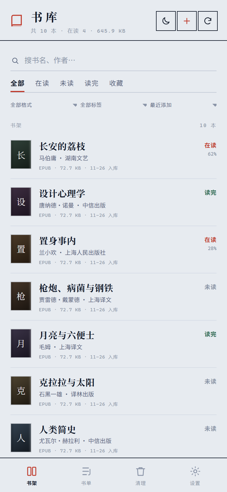
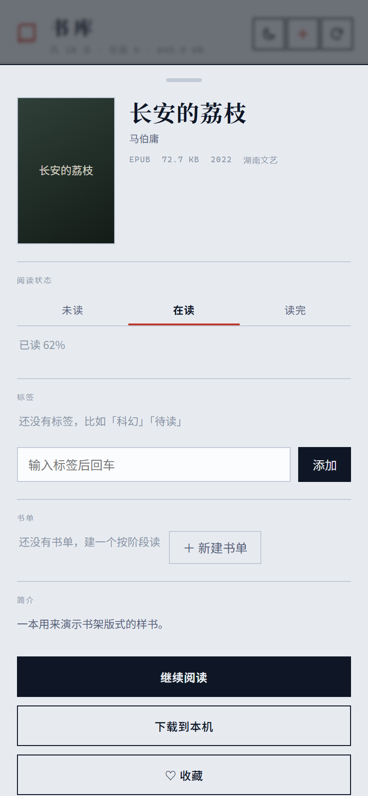
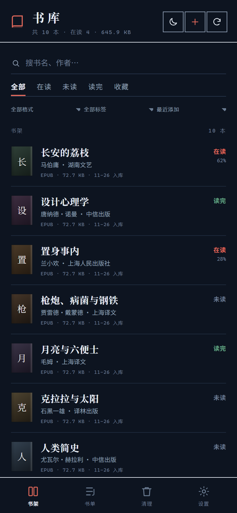
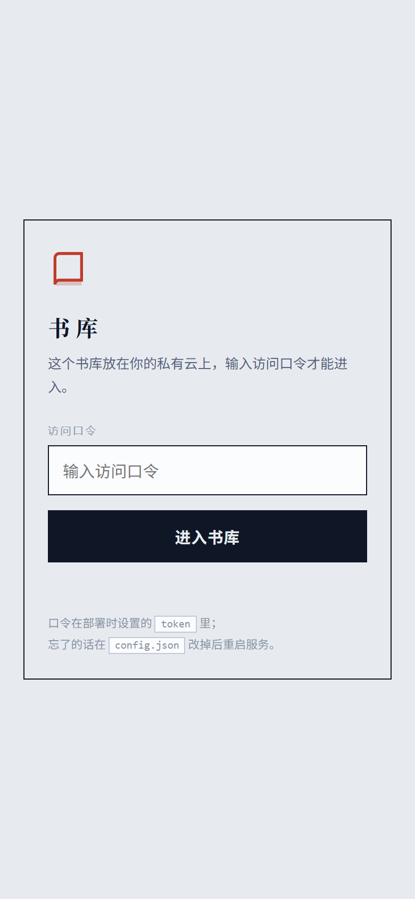

# 书库 · Bookcase

把自己收藏的电子书收进一份干净的索引：搜索、筛选、打标签、建书单、记阅读进度；还能把它挂到自己的 NAS / 私有云上，用手机浏览器上传备份、按书单下载。

整个项目**不联网、不上报任何数据**，原书只读，它只在自己的 SQLite 里建索引。

<p align="center">
  
  
  
  
</p>

## 两种形态，同一套逻辑

| 形态 | 目录 | 说明 |
| --- | --- | --- |
| **Web / 私有云版** | [`bookcase/`](bookcase/) | Python 标准库 + SQLite + 无框架单页前端。本机、Docker、NAS 都能跑；对局域网开放时用访问口令保护。 |
| **Android 版** | [`bookcase-android/`](bookcase-android/) | 用 [Chaquopy](https://chaquo.com/chaquopy/) 把 CPython 3.12 打进 APK，点图标即用，完全离线。 |

## 功能

- **书架**：索引式列表（封面缩略图 + 作者 / 格式 / 入库时间），右侧显示在读、读完与进度；按格式 / 状态 / 标签筛选，按添加时间、书名、作者、大小排序。
- **扫描**：epub / pdf / mobi / azw3 增量扫描，坏文件不会拖垮整次扫描；支持多个书库目录。
- **上传备份**（Web 版）：浏览器里多选文件或整个文件夹，服务端按 SHA1 去重，同名同大小自动跳过。
- **下载**：详情页下载原文件；EPUB 可在内置阅读器里读，退出再进回到上次位置。
- **PDF 阅读**（Android 版）：pdf.js 分片渲染，支持翻页手势和页码记忆。
- **书单**：按阶段 / 主题建独立书架，一本书可进多个书单；整张书单打成一个 ZIP（附书目清单）。
- **标签 / 进度 / 主题**：自由标签、在读/未读/读完；浅色与夜间两套主题，右上角一键切换并记住选择。
- **清理**：重复书、打不开的文件、`(Z-Library)` 脏文件名、PDF 报告类杂项，可逐条或批量处理；重复书归档而不是删除。
- **分享**（Android 版）：把单本书或整张书单（ZIP）走系统分享面板发出去。
- **导出整库**：书 + 书单 / 标签 / 进度的 `manifest.json` 打成一个 ZIP 带走。

## 快速开始

### Web 版（本机）

```bash
cd bookcase
python3 -m pip install -r requirements.txt    # 解析 PDF 封面需要 PyMuPDF（可选）
cp config.example.json config.json            # 改成你自己的书目录
python3 server.py                             # 打开 http://127.0.0.1:8765
```

`config.json` 里最少改 `roots`（书目录）。默认只监听 `127.0.0.1`；要让手机访问，把 `host` 改成
`0.0.0.0` 并设置一个 16 位以上的 `token`。

### Docker / NAS

```bash
cd bookcase
cp .env.example .env          # 设 BOOKCASE_TOKEN、BOOKS_DIR、DATA_DIR
docker compose up -d --build
```

完整部署路线（Docker / SSH / Samba）见 **[部署到联想个人云.md](bookcase/部署到联想个人云.md)**，
联想个人云 T2 用户另有 **[T2 回家部署清单.md](bookcase/T2%20回家部署清单.md)**。

### Android 版

```bash
cd bookcase-android
echo "sdk.dir=/path/to/Android/Sdk" > local.properties   # 这个文件不入库
./gradlew assembleRelease
# 产物：app/build/outputs/apk/release/app-release.apk
```

需要 JDK 17、Android SDK（platform 34 + build-tools 34.0.0）。仓库**不含**发布签名密钥：
按 [`bookcase-android/README.md`](bookcase-android/README.md#签名) 配好 `keystore.properties`
才会产出可安装的签名包。Windows 上注意工程路径不要含中文（AGP 会拒绝）。

> 不想自己编译？[**Releases**](https://github.com/kxiao1429-svg/bookcase/releases/latest)
> 里有打包好的 `bookcase-1.12.0.apk`（arm64，Android 7.0+）。

## 目录结构

```text
.
├── bookcase/                     Web / 私有云版
│   ├── server.py                 HTTP 路由与业务逻辑（标准库 http.server）
│   ├── scan.py                   目录扫描、EPUB/PDF 元数据与封面提取
│   ├── lists.py                  书单
│   ├── static/                   单页前端（epub.js / JSZip / pdf.js 离线内置）
│   ├── deploy/                   NAS 部署辅助脚本
│   ├── tests/                    接口回归 + 界面回归
│   └── tools/bc.py               命令行/给 AI 用的书库工具
├── bookcase-android/             Android 版
│   ├── app/src/main/java/        WebView 壳、权限、分享桥
│   ├── app/src/main/python/      与 Web 版同源的后端 + 前端
│   └── app/build.gradle.kts      Chaquopy 配置、签名读取
└── docs/screenshots/             README 用的截图
```

## 安全与隐私

- **默认只监听 `127.0.0.1`**。对外时必须设 `token`，否则启动时会打印警告。
- 口令支持三种方式：登录后写 Cookie（`HttpOnly` + `SameSite=Lax`）、`Authorization: Bearer`、`?token=`；
  比较用 `hmac.compare_digest`。
- 口令以明文形式存在 `config.json` / `.env` 里，这两个文件已被 `.gitignore` 排除，**不要提交**。
- 仓库里**不含**发布签名的 jks 和口令；`keystore.properties`、`local.properties` 同样不入库。
- 应用本身不发起任何外网请求，也不收集数据；书库只读原书，移动文件只在「清理」里显式发生。
- **不自带 HTTPS**。要放到公网，请在前面套一层 Caddy / Nginx 反向代理并启用 TLS。
- 单一共享口令，没有多用户和权限体系；口令泄露等于全部权限。

## 已知限制

- PDF 的封面和页数依赖 PyMuPDF；没装时 PDF 只按文件名收录，EPUB 不受影响。Android 上没有可用的
  PyMuPDF 轮子，所以 APK 里 PDF 没有封面和页数。
- Android 只打了 `arm64-v8a`；需要模拟器请在 `abiFilters` 里加 `x86_64`。
- 界面和部署路径只在本机 + 局域网验证过，没有在公网环境跑过。

## 第三方组件

前端离线内置了 [epub.js](https://github.com/futurepress/epub.js)、
[pdf.js](https://github.com/mozilla/pdf.js)、[JSZip](https://stuk.github.io/jszip/)，
版权与许可归各自作者，使用或再分发时请遵守对应许可证。

## 更新日志

1.0.0 → 1.12.0 每个版本改了什么、为什么改，见 [CHANGELOG.md](CHANGELOG.md)。

## 许可证

[MIT](LICENSE)

## 说明

- 本项目只用于管理自己合法拥有的电子书，不提供任何书籍内容。
